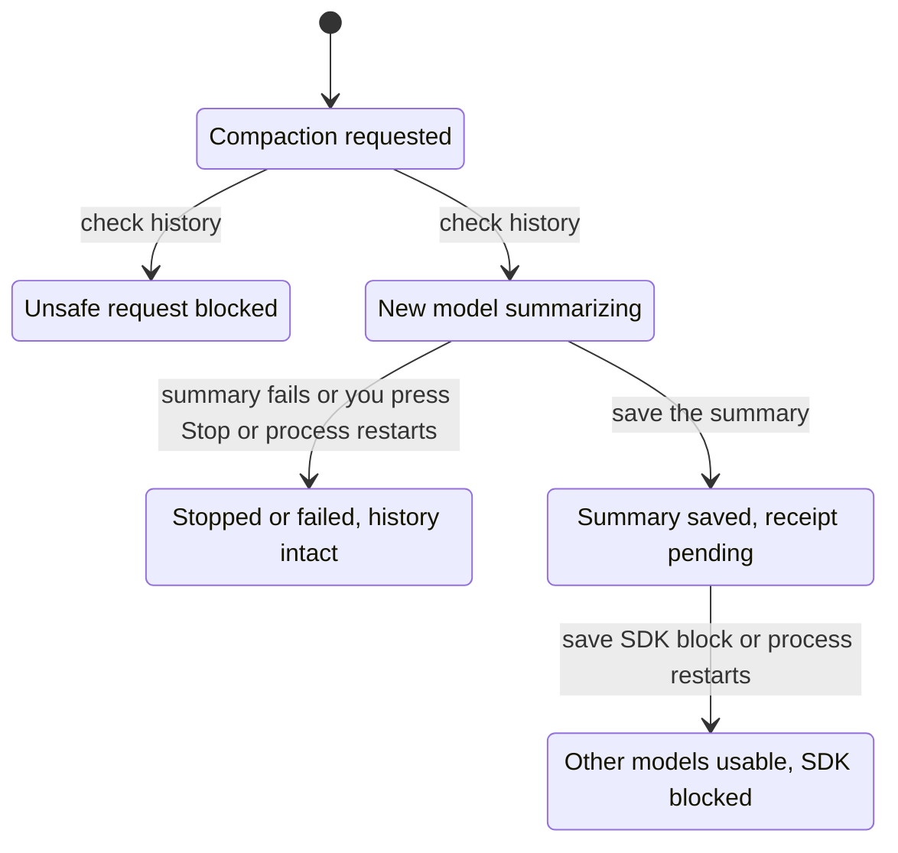

# Foreign compaction verification

The original failure was an SDK rate limit after recorded tool execution. Compaction with a different provider was rejected before that provider received the summary request. The foreign-only path now checks Pi tool results independently and never publishes SDK approval.

TLC 1.7.4 explored 21 distinct states after SDK handoff validation failed and found no violation of the four invariants or deadlock. Real-Pi replay passed seven focused cases on Pi 1.2.0 and the installed Pi 1.5.0. Four existing compaction cases also passed on 1.5.0: manual, compact-away, receipt-gap and null-config. TypeScript checking passed. No full local suite or paid-model call was used for this evidence.

All four broken variants were caught by both TLC and the matching real-Pi replay. /statechart reported these shortest paths:

| Removed protection | Counterexample |
| --- | --- |
| Foreign admission | 0 request → 1 complete foreign history wrongly rejected |
| Missing-result validation | 0 request → 1 foreign summary starts → 2 summary saved despite an unresolved call |
| SDK receipt gate | 0 request → 1 foreign summary starts → 2 summary saved → 3 SDK block saved → 4 unvalidated SDK request opens |
| No premature writes | 0 request → 1 foreign summary starts and prematurely writes state → 2 summary fails but saved history changed |

The unmodified model and focused replay passed after the scratch variants. The checker keeps private raw logs under its printed temporary evidence directory; no real chat or credentials are committed.

## Checked flow

The view hides switching models while the captured summary plan is running and unchanged-state steps. This is a bounded protocol check, not a proof of arbitrary summaries, parser inputs, power-loss durability, branch navigation or physical Safari. See the [verification skill](../../.agents/skills/verify-foreign-compaction/SKILL.md) for the source map, rerun command and maintenance rules.
